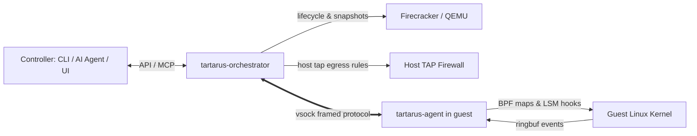

# Tartarus

Tartarus is an ephemeral microVM runtime with live, steerable kernel telemetry and blocking.

You spin up a clean Linux microVM from a memory snapshot in tens of milliseconds, run untrusted code inside it, observe kernel events in real time, and adjust probes or blocking rules while the workload is still running. When the session ends, the VM and its copy-on-write disk are destroyed.

### Use cases

- Sandboxing untrusted code and AI agents where an external controller watches syscalls and tightens network or file rules on the fly.
- CVE reproduction and runtime mitigation labs (reproducing an exploit against a live service, narrowing down the execution path with eBPF, and testing blocking rules or [Shirudo](https://github.com/shirudo-dev/shirudo) upatches against it).
- Dynamic malware behavior analysis with full kernel visibility and host-enforced containment.

## How it works



1. A golden VM is booted once until `tartarus-agent` has loaded its eBPF programs and is blocked on `vsock::accept()`. The orchestrator snapshots its CPU state and RAM.
2. Each new session restores from that snapshot with a fresh copy-on-write root disk and connects over `vsock`.
3. `tartarus-agent` spawns the target workload unprivileged inside a cgroup while keeping kernel-level visibility through eBPF tracepoints, uprobes, and BPF LSM hooks.
4. The host controller reads events live and sends back commands to adjust what gets traced or blocked without restarting the VM or recompiling eBPF bytecode.
5. On teardown, the VM and its CoW disk are destroyed.

Full design details, threat model, and kernel internals live in [docs/architecture.md](docs/architecture.md).

## Workspace layout

```text
crates/
  tartarus-proto/         Shared wire types and framed host<->guest protocol
  tartarus-orchestrator/  Host-side VM lifecycle, snapshot management, and control API
  tartarus-agent/         In-guest daemon, workload runner, and eBPF probe controller
docs/
  architecture.md         System architecture, eBPF model, snapshot lifecycle, threat model
vm/
  cloud-init/             Early guest provisioning configs (QEMU prototyping)
```

## Non-goals

- Static binary analysis (disassembly, decompilation, YARA).
- Rebuilding a full production host-hardening daemon (tools like Shirudo already target production hosts; Tartarus is the disposable lab and sandbox).
- Multi-tenant cloud hosting.
- Windows guest support in v1. The protocol and hypervisor boundary are kept OS-agnostic so a QEMU + ETW/WFP guest can be added later without rewriting the host side.

## Current status

Early scaffolding. `tartarus-proto` defines the initial event structs, and `tartarus-agent` / `tartarus-orchestrator` pass newline-delimited JSON over a local Unix socket.

### v1 milestone

- Bidirectional length-prefixed protocol in `tartarus-proto` (`HostCommand` / `GuestMessage`) with bounded frame sizes.
- Transport trait supporting Unix sockets for local dev and `vsock` for VMs.
- `tartarus-agent` loading map-steered eBPF probes (`exec`, `fork` PID-tree tracking, file open, socket connect) and BPF LSM blocking hooks via `aya`.
- Instant Linux microVM spawn and teardown in `tartarus-orchestrator` using Firecracker memory snapshots + CoW disks.
- Host-side `tap` network isolation so hard egress rules do not depend on trusting the guest kernel.
- Thin CLI and MCP interface on the orchestrator so a human or an AI agent can drive a session end-to-end.

## Host requirements (for VM + eBPF runs)

- Linux with `/dev/kvm` (bare metal, or WSL2 with `nestedVirtualization=true`). Most standard cloud VPS instances do not expose `/dev/kvm`.
- Guest kernel built with `CONFIG_BPF_SYSCALL=y`, `CONFIG_BPF_LSM=y`, `CONFIG_DEBUG_INFO_BTF=y`, `CONFIG_VIRTIO_VSOCKETS=y`, and booted with `lsm=...,bpf`.
