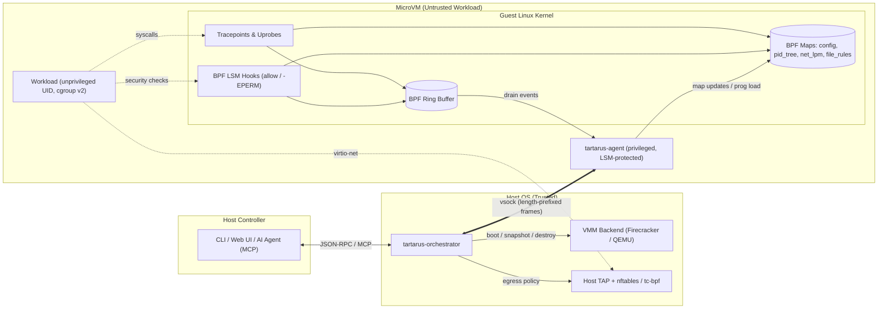
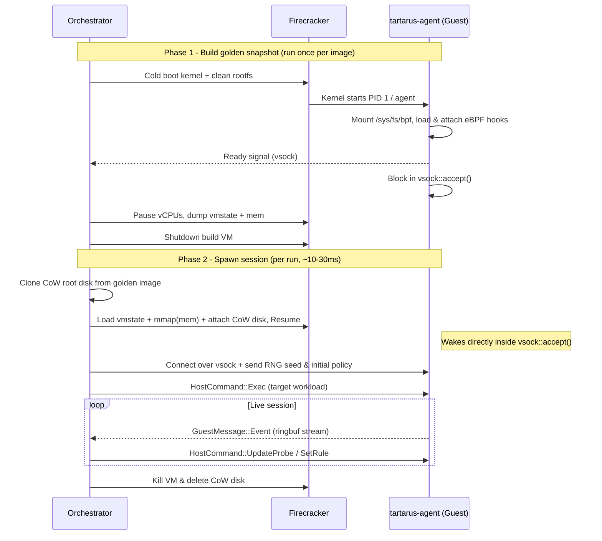

# Tartarus Architecture

This document describes the system design, kernel boundaries, and open tradeoffs for Tartarus. The goal is a fast, inspectable microVM runtime where a host controller (a CLI, web UI, or AI agent) can observe kernel activity live and change tracing or blocking rules mid-run.

## System overview



Three design rules shape the rest of this document:

1. Keep the control plane out of the guest network stack. Control traffic uses `vsock`, never TCP over `virtio-net`.
2. Express commands in terms of intent, not Linux kernel internals, so the host does not hardcode eBPF map layouts into its external API.
3. Never assume the guest kernel is trustworthy. In-guest eBPF gives deep visibility and fast local blocking, while hard containment lives on the host.

## Snapshot lifecycle

Cold-booting a VM with `cloud-init`, mounting filesystems, and verifying eBPF programs takes seconds. To get sub-50ms startup, VM creation is split into two phases.



### Snapshot edge cases to handle

Restoring memory snapshots directly introduces a few failure modes that cold boots do not have:

- **Duplicated kernel RNG state.** Two VMs restored from the same memory file start with the exact same CSPRNG state and will generate identical random bytes until reseeded. On wakeup, the orchestrator sends fresh host entropy over `vsock` (or exposes `virtio-rng`) before spawning the workload.
- **Root disk corruption.** Memory snapshots restore guest RAM, not disk blocks. Every restored VM gets its own copy-on-write root disk (XFS/Btrfs reflink, `dm-thin`, or `qcow2` overlay) so concurrent runs never write to the backing image.
- **No stale sockets across snapshots.** The golden snapshot is taken while `tartarus-agent` is idle and blocked in `accept()`, before any workload starts or any external TCP sockets exist. Each restored VM receives a fresh host connection.
- **Monotonic timestamps.** Guest monotonic clocks resume from the snapshot timestamp. Event timestamps are treated as per-session ordering values, not wall-clock dates.

## Transport and wire protocol

### Why `vsock` instead of Unix sockets or TCP

A Unix domain socket (`AF_UNIX`) is an inode inside one kernel's VFS. Once `tartarus-agent` moves inside a VM, it runs on a separate kernel and cannot open `/tmp/tartarus.sock` on the host.

`AF_VSOCK` runs over virtio shared-memory rings between guest and host, addressed by `(CID, port)` with no IP stack involved:

- The guest can run completely air-gapped (no `virtio-net` device at all) or have its network tables mangled by malware, and the control plane keeps working.
- Restoring multiple clones from the same snapshot does not create IP or MAC address collisions on the control channel.
- No guest-side network config, DHCP, or SSH setup is needed.

Under Firecracker, the guest opens a normal `AF_VSOCK` socket and Firecracker bridges it to a host-side Unix socket with a short `CONNECT <port>\n` handshake. Under QEMU (`vhost-vsock-pci`), both sides use `AF_VSOCK`.

Both `tartarus-agent` and `tartarus-orchestrator` talk over an abstract stream trait (`Read + Write` / `AsyncRead + AsyncWrite`) so local development and unit tests can still run against a plain Unix socket on the host without booting a VM.

### Framing and host safety

The early prototype used newline-delimited JSON with `BufRead::read_until(b'\n')`. That is unsafe once the peer is untrusted: a compromised guest can send bytes forever without a newline and OOM the host orchestrator.

The wire format switches to length-prefixed frames:

```text
+-------------------+-----------------------------------+
| u32 big-endian    | payload (max 64 KiB)              |
| payload length    | serialized message                |
+-------------------+-----------------------------------+
```

The host rejects any frame header above the cap before allocating, enforces a per-VM rate limit, and routes events through bounded channels so a noisy guest cannot stall the orchestrator.

### Protocol shape (`tartarus-proto`)

Commands are OS-agnostic intent rather than raw BPF map operations. That keeps the external API clean and leaves room for a non-Linux guest agent later.

Host -> Guest (`HostCommand`):
- `InitSession { rng_seed, initial_probes }`
- `Exec { program, args, env, cwd, unprivileged }`
- `SetProbeMask { categories }` (coarse toggles: exec, file, net, dns, creds)
- `WatchPidTree { pid, categories }` (zoom in on a specific process subtree)
- `SetNetworkRule { cidr, port, action }` (`Allow | Log | Deny`)
- `SetFileRule { path_prefix, action }` (`Allow | Log | Deny`)
- `KillPid { pid, signal }`
- `LinuxExt(...)` (explicit escape hatch for Linux-only hooks like attaching a uprobe to `libssl.so:SSL_write` or loading a custom eBPF ELF)

Guest -> Host (`GuestMessage`):
- `Ready`
- `CommandAck { request_id, result }`
- `Event { seq, pid, tgid, uid, timestamp_ns, kind }`
- `Stats { dropped_ringbuf_events, active_probes }`

## Guest internals and eBPF model

### PID 1 vs. systemd

Linux does not require `systemd`. Passing `init=/usr/bin/tartarus-agent` on the kernel command line makes the kernel launch the agent directly as PID 1.

When running as PID 1, `tartarus-agent` mounts `/proc`, `/sys`, `/dev`, `/sys/fs/bpf`, and `/sys/fs/cgroup`, reaps orphaned children on `SIGCHLD`, and never exits. Because no background daemons (`cron`, `journald`, `snapd`) exist in this image, nearly every kernel event comes directly from the workload.

For workloads that expect a normal service manager (multi-service CVE labs or malware that checks for `systemd`), the same binary can run as a regular early-boot service under `systemd`. The agent checks `std::process::id() == 1` at startup to decide whether to run minimal init setup.

### Observing vs. blocking

Killing a process from a `kprobe` or `tracepoint` with `bpf_send_signal(SIGKILL)` has a TOCTOU race: the syscall often finishes before userspace handles the signal. Tartarus separates observation from enforcement by hook type:

| Mechanism | Purpose | Why |
| --- | --- | --- |
| Tracepoints (`sched_process_exec`, `sched_process_fork`, `inet_sock_set_state`) | Coarse and fine telemetry | Stable ABI across kernel versions compared to kprobes. |
| BPF LSM (`bprm_check_security`, `file_open`, `socket_connect`) | Synchronous blocking | Runs inline before the operation completes and returns `0` or `-EPERM`. `file_open` sees the resolved `dentry`/`inode`, avoiding symlink and `../` races. |
| Uprobes (attached on demand) | Deep userspace inspection | Lets the controller inspect plaintext TLS (`SSL_read`/`SSL_write`) or language runtimes only when a process looks interesting. |

### Map-driven live steering

Compiling and verifying new eBPF C/Rust programs on every agent decision is slow and fragile. Instead, `tartarus-agent` loads a fixed set of `aya` eBPF programs once before the snapshot is taken, and live steering works by updating their BPF maps:

- `CONFIG_MAP` (`Array`): Global probe bitmask and audit-vs-enforce mode.
- `WATCHED_PIDS` (`HashMap<u32, WatchPolicy>`): Tracks zoomed-in process trees. Inside `sched_process_fork`, the eBPF program checks if the parent PID is watched and inserts the child PID directly in kernel space. Doing inheritance in-kernel prevents short-lived child processes from exiting before userspace learns about them.
- `NET_POLICY` (`LPMTrie`): Fast CIDR + port lookups (`Allow | Log | Deny`).
- `FILE_POLICY` (`HashMap`): Path/inode rules for sensitive files (`/etc/shadow`, `~/.ssh`, etc.).
- `EVENTS` (`BPF_MAP_TYPE_RINGBUF`): Single cross-CPU ring buffer preserving global event order. When `reserve()` fails under load, a per-CPU drop counter increments and is reported to the host in `GuestMessage::Stats` so silent telemetry loss is visible.

### Fast path vs. slow path

Kernel hooks never block waiting on the host or an LLM.

- **Fast path (in-kernel, nanoseconds):** Check BPF maps, enforce existing rules (`-EPERM` or allow), push event to ring buffer.
- **Slow path (host controller, milliseconds to seconds):** Consume event stream, decide whether to zoom in or block, push a `HostCommand` that updates the BPF maps or signals the offending cgroup/PID.

Once the map-driven loop is solid, a Tier 2 escape hatch can load arbitrary signed eBPF bytecode (or Shirudo upatches) for cases that fixed maps cannot express.

## Security model

The design uses two separate boundaries and treats them differently.

### Boundary 1: Inside the guest (agent vs. workload)

`tartarus-agent` starts as `root` with `CAP_BPF` and `CAP_SYS_ADMIN`, loads its probes, and spawns the workload inside a dedicated cgroup v2 under an unprivileged UID with dropped capabilities and `PR_SET_NO_NEW_PRIVS`.

Before any workload runs, the agent attaches three small BPF LSM self-protection hooks:
- `bpf`: deny (`-EPERM`) unless caller is `tartarus-agent` (blocks unloading hooks or reading/writing BPF maps).
- `task_kill` and `ptrace_access_check`: deny if target is `tartarus-agent`.

This prevents unprivileged workloads and normal userspace escalations from blinding the agent. It does *not* defend against a guest kernel 0-day.

### Boundary 2: Guest vs. host (untrusted VM)

Assume a hostile workload achieves ring-0 inside the guest kernel. The host remains isolated:

1. **Host-side network enforcement.** Each VM gets a host `tap` interface behind `nftables` or host `tc`/XDP eBPF rules (default-deny egress, RFC1918 and host loopback blocked, explicit allowlist when internet access is enabled). A guest kernel rootkit cannot bypass host packet filters.
2. **Untrusted `vsock` parsing.** Strict frame size limits, bounded queues, and per-VM rate limits in `tartarus-orchestrator`.
3. **VMM containment.** Run Firecracker inside its `jailer` (`chroot`, `seccomp`, dropped privileges) with cgroup limits on CPU, RAM, and disk IOPS.
4. **No shared host state.** CoW disks are unlinked on teardown; no host directories are bind-mounted into the guest by default.

## Hypervisor backends and future Windows guests

`tartarus-orchestrator` hides the hypervisor behind a `VmBackend` trait (`crates/tartarus-orchestrator/src/vm.rs`):

- **Firecracker (primary Linux backend).** Minimal attack surface, ~5 MB overhead per VM, native userspace `vsock` bridged to a host Unix socket (which also makes it work cleanly on WSL2 with `/dev/kvm`), and ~10-30 ms memory snapshot restores. Linux guests only.
- **QEMU + KVM (secondary / future Windows backend).** Slower cold boot and larger emulated surface, needed when debugging with full hardware or running Windows guests.

Windows does not have general-purpose Linux eBPF (Microsoft's `ebpf-for-windows` mainly covers networking). Adding Windows guests later requires:
- Running the guest on the `QemuBackend` with `virtio-win` drivers.
- Writing a `tartarus-agent-win` binary that speaks the same `tartarus-proto` wire format, backed by ETW (telemetry), WFP (network blocking), and optionally a filesystem minifilter driver (file blocking) in test-signing mode.

Keeping `tartarus-proto` intent-based and `VmBackend` trait-based avoids paying any of that Windows complexity in v1 while keeping the path open.

## Open questions

- **Wire serialization:** Stick with JSON inside length-prefixed frames for debuggability in v1, or switch early to `postcard` / `msgpack` for lower event overhead?
- **CoW disk backend on host:** `cp --reflink=auto` (simplest on XFS/Btrfs), `overlayfs`, or `dm-thin`?
- **Artifact capture:** Which post-run artifacts belong in v1 (pcap from the host `tap`, CoW disk diff, guest memory dump) vs. later?
- **Shirudo integration:** Whether to support loading Shirudo's signed upatch format directly as a Tier 2 probe/shield backend once the guest kernel matches its requirements.
